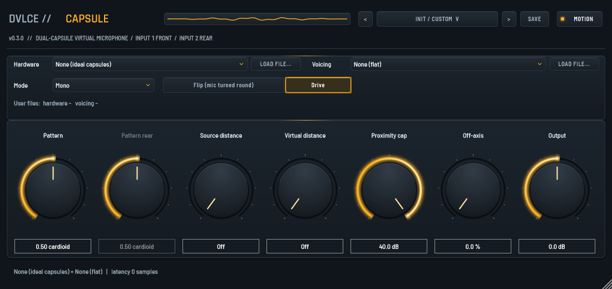

# Dvlce Capsule

A virtual microphone for dual-capsule (front and rear) microphones. Record both capsules,
then choose the polar pattern after the take: omni, cardioid, figure-8 and everything between.
It also corrects the capsules, removes or adds proximity effect, adds off-axis colour, and has a
Stereo 180 mode (two virtual mics, one facing front, one facing back).



**v0.3.0.** Plugin formats: **VST3** and **Standalone** (Windows, macOS), **AU** (macOS).

## Download

Built plugins are on the [Releases page](https://github.com/toyuvalo/dvlce-capsule/releases).
- Windows: copy `Dvlce Capsule.vst3` to `C:\Program Files\Common Files\VST3\`.
- macOS: copy `Dvlce Capsule.component` to `~/Library/Audio/Plug-Ins/Components/` and
  `Dvlce Capsule.vst3` to `~/Library/Audio/Plug-Ins/VST3/`. The builds are not notarised: if macOS
  blocks them, run `xattr -dr com.apple.quarantine "<path to the plugin>"` once.

## Use

1. Record the two capsules of your microphone on two tracks, or on one stereo track: **left = front capsule, right = rear capsule**.
2. Put Dvlce Capsule on the stereo track (or on a stereo bus fed by the two tracks).
3. Turn **Pattern**: 0 = figure-8, 0.25 = hypercardioid, 0.5 = cardioid, 0.7 = subcardioid, 1 = omni.
4. Optional:
   - **Flip**: the mic was turned round, or the inputs are swapped.
   - **Source distance**: removes the bass boost of a close source. Set it to the distance of the source.
   - **Virtual distance**: adds the bass boost of a closer source. **Proximity cap** limits that boost.
   - **Mode → Stereo 180**: two virtual mics, front (left) and back (right), each with its own pattern.
   - **Voicing**: Neutral, Bright, Warm, or your own file. **Off-axis** sets how much of the voicing's
     off-axis colour is used. **Drive** turns the voicing's saturation on or off.
   - **Hardware**: the capsule tables of your own microphone (a model file), to correct its capsules.

Voicings with an off-axis table add 1022 samples (21 ms at 48 kHz) of latency. The plugin reports it, so the host compensates.
The Standalone app takes inputs 1 and 2 of your audio interface as front and rear.

## Model files

Hardware and voicing models are JSON files in the format of [`SPEC.md` §8](SPEC.md).
Examples: [`proto/models/`](proto/models/). Load your own with **Load file...**. The file is checked
when you load it (a refused file shows the reason) and is saved inside your session.

## Build from source

Needs CMake 3.22 or newer and a C++17 compiler. JUCE 8.0.13 is fetched automatically.
- Windows (Visual Studio 2022 or Build Tools, Ninja): `build-win.bat` (set `CMAKE`, `NINJA`, `BUILD_DIR` if they are not on the PATH).
- macOS (Xcode): `./build-mac.sh` (universal arm64 + x86_64).
- Core and tests only, without JUCE: `build-win.bat core` or `./build-mac.sh core`.

The build also runs the C++ tests: the model-file rules, real-time checks, and a comparison with the
Python prototype (needs Python with numpy and scipy).
Render the editor to a PNG without a window: `DvlceCapsuleSnapshot <out.png> [voicing index]` (built with the plugin).
Check a built plugin against the prototype: `python bench/parity_plugin.py "<path to the plugin binary>"` (needs `pedalboard`).

The Python prototype:
```
cd proto
pip install -r requirements.txt
python -m pytest -q          # 134 tests
python mutate.py             # 22 deliberate bugs; each one must make the suite fail
```

### JUCE licence

The plugin links [JUCE 8](https://juce.com), which has its own licence: AGPLv3 or a JUCE licence
(the free Starter tier, or Indie/Pro). The released builds are made under the author's JUCE licence.
If you build and share your own binaries, JUCE's terms apply to you as well.

## Licence

**Free for non-commercial use. Commercial use needs a paid licence.**

The code, the spec and the example models are under the
[PolyForm Noncommercial License 1.0.0](LICENSE).

- You may use, change and share it for any non-commercial purpose:
  personal projects, hobby, study, research, education, charities and public bodies.
- To sell it, ship it in a paid product, or use it in commercial work,
  you need a commercial licence from the author first. See [`COMMERCIAL.md`](COMMERCIAL.md).

This is source-available software, not OSI "open source". The `LICENSE` text governs; this section is a summary.

Required Notice: Copyright 2026 Yuval Olsha (https://github.com/toyuvalo)

## Quantum interface and presets (0.3.0)

The amber Quantum interface uses the shared DVLCE knob, chip and font styles.
The MOTION lamp switches the header animation on or off. This setting is stored with the session
and remembered for new instances. All hardware, voicing and user model controls remain available.

Use the header arrows or the category menu to load one of 16 designed factory presets.
These are starting points; use matching front/rear recordings and select your measured hardware model when available. Factory presets use ideal capsules, not a model of a named microphone. Figure Eight Side is a side-channel starting point; it does not rotate a front/rear capsule pair.
An asterisk marks changed parameter values. SAVE creates a JSON user preset under
`juce::File::userApplicationDataDirectory/Dvlce/Presets/Capsule/`.
Repeat names get numbered filenames. User presets include the plugin state
and embedded custom model data; they do not require the original model file.
Factory presets are embedded from [presets/factory.json](presets/factory.json), in real parameter units.

The vendored UI code lives in `plugin/Source/ui/`; it has no private repository dependency.
Rajdhani by Indian Type Foundry and Barlow Semi Condensed by Jeremy Tribby use the SIL Open Font License:
[OFL-Rajdhani.txt](plugin/Source/ui/fonts/OFL-Rajdhani.txt),
[OFL-Barlow.txt](plugin/Source/ui/fonts/OFL-Barlow.txt).
Only the two font families and the needed theme, look-and-feel and header/preset code are included.

GitHub-hosted Windows and macOS workflows build the plugins, run core and preset tests,
validate at pluginval strictness 10 with GUI tests skipped, and render offscreen editor PNGs.
The snapshot tool verifies the saved PNG and prints the full-editor paint time at 100%.
`docs/editor.png` comes from the CI snapshot artifact.
